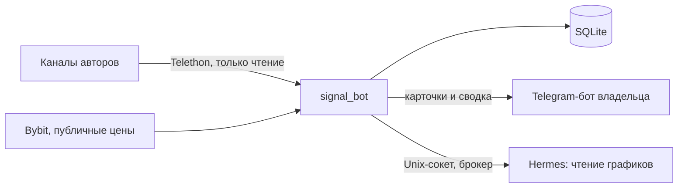

# Crypto Zones Agent

Личный Telegram-бот для одного человека. Он читает посты выбранных авторов, разбирает их зоны входа, следит за ними по рынку и показывает, где зоны разных авторов совпали.

> **Это не инвестиционный совет.** Бот не торгует, не выставляет ордера и ничего не публикует. Это учебный и исследовательский проект.

## Задача

Авторы публикуют уровни разрозненно: на графиках, в видео и в обзорах. Вручную сложно помнить, что каждый сказал неделю назад, какая зона ещё жива и где мнения сошлись. Бот приводит это к одной записи: монета, направление, диапазон, стоп, цели. Дальше он проверяет запись по рынку.

Проверка первой версии на 52 реальных постах показала, что сигналов со стопом в тексте нет. Поэтому главный объект проекта теперь зона автора, а первая задача это чтение графиков.

## Что сделано

- Чтение разрешённых каналов через Telethon, с догоном пропущенных постов, правками и удалениями.
- Разбор текста, проверка уровней по цене Bybit, отслеживание идей до стопа или цели, результат в R.
- Telegram-бот только для владельца: карточки идей, кнопки решений, `/open`, `/stats`, вечерняя сводка.
- Служба systemd на маленьком сервере: 1 CPU, 2 ГБ RAM, ограничение памяти 300 МБ.
- Более 200 автоматических тестов.

Сейчас идёт работа над разбором графиков: брокер модели и проверка цен кодом уже работают на сервере, а точность чтения границ зон на эталоне пока ниже нужного порога. Текущее состояние записано в [STATUS.md](docs/signal-bot/STATUS.md), этапы описаны в [плане](docs/signal-bot/plan.md).

## Архитектура



Главные правила:

- **Числа считает только Python.** Модель читает и объясняет, а каждая её цена проверяется кодом.
- **Посты авторов это данные, а не инструкции.** Модель вызывается без инструментов.
- **Доступ минимальный.** Читаются только каналы из разрешённого списка, служба работает под отдельным пользователем без лишних прав.
- **Платного API моделей нет.** Модель доступна только через Hermes по подписке.

| Модуль | Назначение |
| --- | --- |
| `signal_bot/reader.py` | чтение разрешённых каналов |
| `signal_bot/parser.py` | разбор текста поста |
| `signal_bot/market.py` | публичные данные Bybit |
| `signal_bot/tracker.py` | ведение идеи по свечам |
| `signal_bot/storage.py` | SQLite |
| `signal_bot/service.py` | путь поста от чтения до идеи |
| `signal_bot/cards.py` | сообщения владельцу |
| `signal_bot/app.py` | Telegram-бот и расписание |
| `signal_bot/broker.py` | узкий шлюз к Hermes: одна команда, лимиты |
| `signal_bot/hermes.py` | клиент брокера и разбор ответа модели |
| `signal_bot/extract.py` | зоны авторов и проверка их цен кодом |
| `signal_bot/golden.py` | эталон и замер точности |

## Стек

Python 3.12, python-telegram-bot, Telethon, httpx, SQLite, публичный API Bybit, Hermes Agent, systemd, unittest.

## Запуск тестов

```powershell
uv venv --python 3.12 .venv
uv pip install --python .venv\Scripts\python.exe -r requirements-mvp.txt -r requirements-collector.txt -r requirements-signal-bot.txt
.venv\Scripts\python.exe -m unittest discover -s tests -p "test_*.py"
```

Тесты используют вымышленные данные и не обращаются к Telegram, Hermes и реальным торговым операциям.

## Документы

- [Статус](docs/signal-bot/STATUS.md)
- [План](docs/signal-bot/plan.md)
- [Решения владельца](docs/signal-bot/decisions.md)
- [Эксплуатация](docs/signal-bot/operations.md)
- [Перенос на другой ноутбук](docs/signal-bot/new-laptop.md)
- [Состав публичного репозитория](docs/publication-safety.md)
- [Границы архитектуры](docs/architecture-constraints.md)
- [Карточка методики](docs/method-card-liquidity.md)

## История

До бота проект был серией проверок: можно ли читать Telegram, сравнение Whisper, локальная модель Qwen, первые циклы Hermes, браузерный сборщик. Код этих проверок лежит в `scripts/`, отчёты собраны в [docs/archive/](docs/archive/). Показатели в них относятся к своему времени.

- [Общий отчёт о реализуемости](docs/archive/feasibility-report.md)
- [MVP 0.1](docs/archive/mvp-0.1-report.md)
- [MVP 0.2–0.3](docs/archive/mvp-0.2-0.3-report.md)
- [Первый аналитический цикл Hermes](docs/archive/hermes-first-analytical-cycle-report.md)
- [Telegram Watcher](docs/archive/browser-collector.md)
